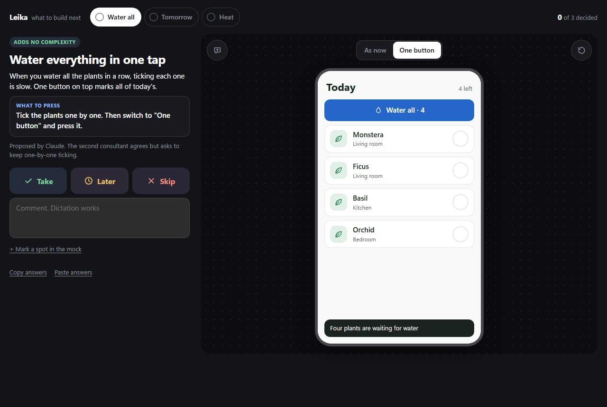
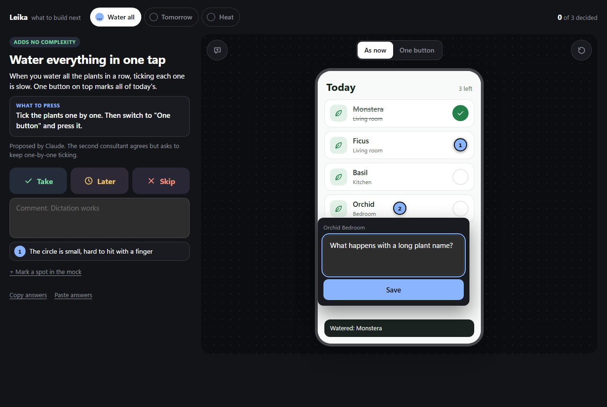
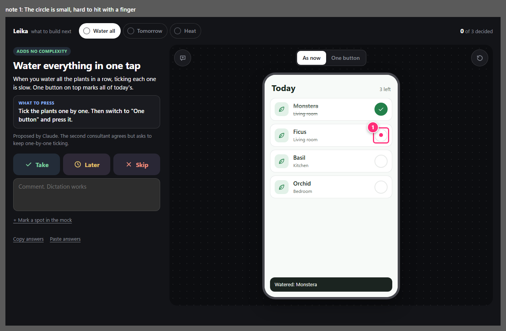

<p align="center"><b>EN</b> · <a href="README.ru.md">RU</a></p>

<h1 align="center">Try and vote</h1>

<p align="center">
  <a href="LICENSE"></a>
  
  
  
</p>

<p align="center">
  <a href="#install">Install</a> · <a href="#what-the-owner-sees">What the owner sees</a> · <a href="#notes-on-the-mock">Notes on the mock</a> · <a href="#how-it-works-for-the-agent">For the agent</a> · <a href="#measured">Measured</a>
</p>

Try and vote is a skill for coding agents. Agents usually propose features as a wall of text, and the product owner has to read proposals, imagine interfaces and guess trade-offs. With this skill the agent builds one interactive page instead. You touch each candidate feature inside a mock of your real product, switch between variants, and answer take, later or skip with a comment. The agent reads your answers back and acts on them.

<p align="center">
  
</p>

https://github.com/user-attachments/assets/4be38fc1-d675-4c79-9dc9-5c0d044b51e2

## Install

```sh
npx skills add Sargares22/try-and-vote
```

Then ask your agent to show you the options, for example: "show me three ways to do the onboarding, I want to try them".

Needs Node.js 18 or newer and Chrome, Chromium or Edge. Inside WSL the Windows browser is used. No other dependencies.

## What the owner sees

- **A tab for each candidate feature**, marked once it is decided.
- **A brief.** What the feature is, how much it complicates the product, and what to press.
- **A switch** between variants, or between "as now" and the new behaviour. What the switch changed in the mock is ringed for a moment, so the difference is never a guess.
- **A working mock** on a phone, a tablet, a desktop window, a browser, a single component or the full stage.
- **Three verdict buttons:** take, later, skip.
- **A comment box.** Dictation works.
- **A "done" button** that hands the answers to the agent.

## Notes on the mock

Press "mark a spot", then press any place in the mock and write what is wrong there. A numbered mark stays on the spot and the note joins the list under your comment.

<p align="center">
  
</p>

The agent gets each note with the element you pressed, its coordinates inside the mock, and a picture of the mock as you saw it: buttons pressed, text typed, lists scrolled, the spot ringed and numbered.

<p align="center">
  
</p>

## How it works for the agent

1. **Init.** `node scripts/demo.mjs init <folder>` writes a starter `demo.html`.
2. **Write one file.** Fill `demo.html` with the product mock and the tabs. The frame around it comes from the script.
3. **Check.** `node scripts/demo.mjs check <folder>/demo.html` checks the rules and takes pictures.
4. **Serve.** `node scripts/demo.mjs serve <folder>/demo.html` in the background; give the owner the address.
5. **Read answers.** When the owner presses "done", the server prints the answers in piles, draws the noted spots and exits.

The server also exits by itself 20 minutes after the page was closed, and runs once per page.

It works in any agent harness that can run commands. A harness that cannot (Antigravity without a window) can still write the page, but someone else has to run the check for it. A Claude artifact can hold the page too, as an extra. With no server at all, the page opens from disk and the owner presses "copy answers".

## What the script enforces

- Text limits on titles and descriptions, so the owner tries features instead of reading essays.
- Something to press in every tab, and a visible answer to the press.
- No sideways scroll at phone width (400 px).
- Tabs changed since the owner last looked are marked as updated.
- One sheet of pictures per tab, every state side by side, for the agent to look at before showing the page.

## Measured

Fifteen builds by three Claude models (Opus 5.5, Sonnet 5.5, Haiku 5.5), five each. Every build ran in a fresh thread; the three models got the same three briefs.

- All 15 passed the script's rules and a grader that presses the built page itself.
- Mean time was 3.7 to 4.5 minutes per page.
- In a blind look at the pictures of one task, the larger models adapted the mock to phone width better than the smallest. The script did not see that difference; eyes did.
- Other vendors, all three briefs each, one build per brief. Codex built and checked every page by itself, 6 to 12 minutes and 60 to 100 thousand tokens a page. Antigravity (Gemini 3.8 Flash) wrote every page in 5 to 9 minutes but could not run the check, since its headless mode refuses shell commands; the check was run for it. All six pages passed the rules and the pressing grader as first written.
- Not measured: real products with real source files. Notes on the mock were added after the Claude runs.

## Limits

The mock is drawn by the agent and is only as faithful as the files it was given. The script checks that controls respond; taste is still judged by eyes. A note's picture is redrawn from the mock's markup, so a canvas or a video inside the mock may look different in it.

## Developing the skill

`node tests/run.mjs` tests the rules and the server. `node scripts/demo.mjs eval --prepare <dir>` and `eval <dir>` check whether a given model can build pages by this skill; the grader's steps are in `evals/`.

## License

[MIT](LICENSE)
